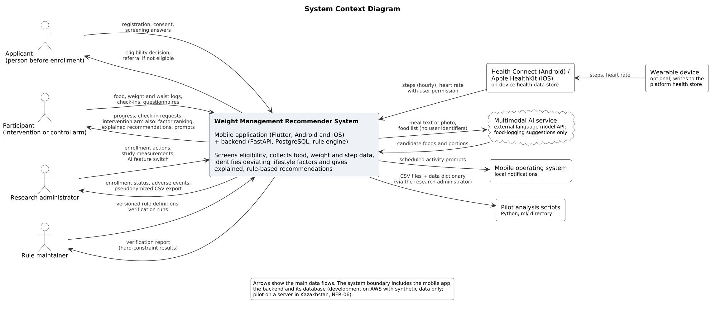
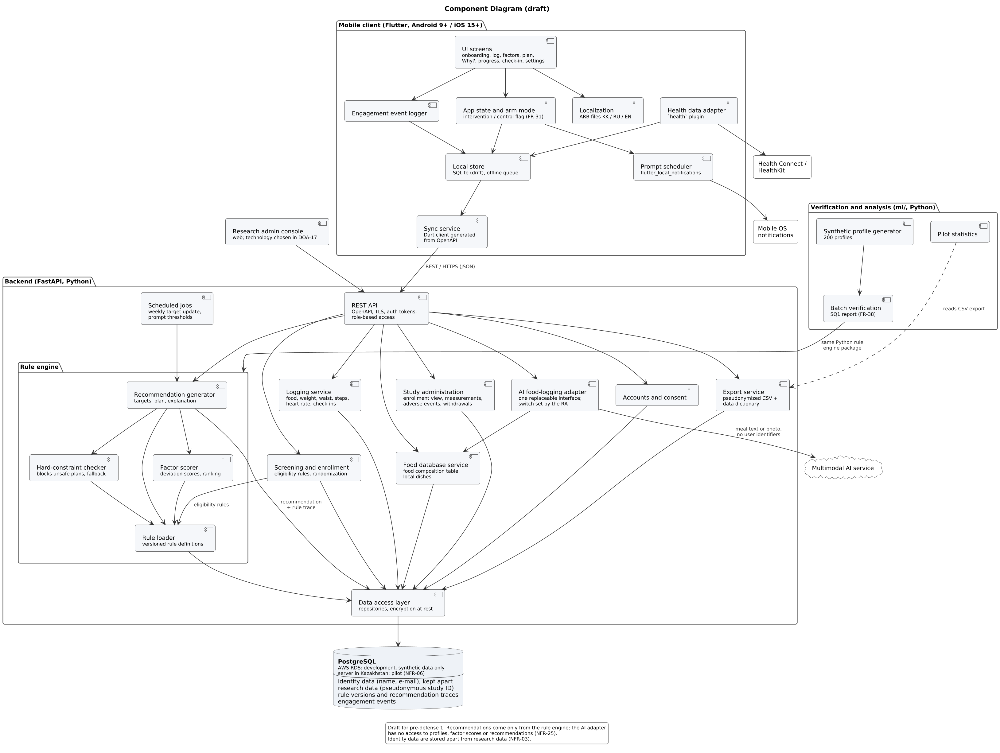

# System Architecture

| | |
|---|---|
| **Pre-defense item** | 7. Architecture and diagrams (context diagram, component diagram draft) |
| **YouTrack task** | [DOA-9](https://yeralytemir.youtrack.cloud/issue/DOA-9); use cases in [DOA-10](https://yeralytemir.youtrack.cloud/issue/DOA-10) |
| **Version / date** | 0.1 draft, 22 October 2026 |
| **Inputs** | [Requirements specification](../requirements/requirements.md) v1.4; [technology comparison](technology-comparison.md) (DOA-7); [prototype](../prototype/README.md) (DOA-11); [evaluation plan](../evaluation/evaluation-plan.md) (DOA-12) |
| **Diagrams** | [`diagrams/`](diagrams/): PlantUML sources (`.puml`) and PNG / SVG exports; see [diagrams/README.md](diagrams/README.md) |

---

## 1. Overview

The system is a client–server application with three parts:

1. a **mobile client** written in Flutter that runs on Android and iOS from one code base and keeps working without a network connection;
2. a **backend** written in Python with FastAPI that exposes a REST API, holds the versioned rule base and runs the rule engine that identifies each participant's deviating lifestyle factors and generates recommendations;
3. a **PostgreSQL database** that stores identity data apart from pseudonymous research data.

The verification code in `ml/` reuses the backend's rule engine package to check the rules on 200 synthetic profiles before the pilot (SQ1), and analyses the pilot export.

Three architectural principles follow from the requirements:

| Principle | Reason | Requirements |
|---|---|---|
| **Recommendations only from versioned rules.** The rule engine is the only component that produces factor scores and recommendations; every output stores the rule ID, version and input snapshot. AI is used only to pre-fill food log entries that the user confirms. | Explanation, reproducibility and safety of advice | FR-23, FR-24, FR-37, NFR-22, NFR-23, NFR-25 |
| **Offline-first client.** Every user action is written to a local SQLite store first and synchronized later. | Logging must not depend on the network | NFR-12 |
| **Separation of identity and research data.** Name and e-mail are kept apart; research data, events and exports use a pseudonymous study ID only. | Privacy and data protection | NFR-03, NFR-05, FR-35 |

---

## 2. System Context

Source: [`diagrams/context.puml`](diagrams/context.puml) · [SVG](diagrams/context.svg)

The context diagram shows the system as one box, the four human actors and the external systems it exchanges data with. The human actors are the same as in the [use case diagram](use-cases.md); the two study-arm participants are shown as one actor here because they exchange the same kinds of data with the system.

| External element | Data exchanged | Requirements |
|---|---|---|
| Applicant | Registration, consent, screening answers → eligibility decision or referral | FR-01 to FR-05 |
| Participant (intervention or control arm) | Logs, check-ins, questionnaires → progress; in the intervention arm also factor ranking, explained recommendations and prompts | FR-06 to FR-33 |
| Research administrator | Enrollment actions, study measurements, AI switch → enrollment status, adverse events, CSV export | FR-30, FR-34 to FR-36, FR-40 |
| Rule maintainer | Rule definitions, verification runs → verification report | FR-37, FR-38 |
| Health Connect / HealthKit | Hourly steps from the phone; steps and heart rate from a wearable | FR-10, FR-11, NFR-21 |
| Wearable device | Writes to the platform health store; never connected to the system directly | FR-11 (decision D6) |
| Multimodal AI service | Receives meal text or photo and the food list without user identifiers; returns candidate foods and portions | FR-40, NFR-25 |
| Mobile operating system | Shows the activity prompts that the app schedules as local notifications | FR-25, NFR-15 |
| Pilot analysis scripts (`ml/`) | Receive the pseudonymized CSV export and data dictionary | FR-35, NFR-27 |

---

## 3. Use Cases

The use case model (28 use cases, actors, include and extend relationships, mapping to all 40 functional requirements) is in [use-cases.md](use-cases.md).

---

## 4. Components

Source: [`diagrams/component.puml`](diagrams/component.puml) · [SVG](diagrams/component.svg). The diagram is a **draft** for the first pre-defense; component boundaries may change during implementation (DOA-17 to DOA-22), and changes are recorded in this document.

### 4.1 Mobile client (Flutter)

| Component | Responsibility | Requirements |
|---|---|---|
| UI screens | Onboarding, log, factors, plan, "Why?", progress, check-in, settings; built in the prototype (DOA-11) | FR-01 to FR-40 (user-facing parts) |
| App state and arm mode | Holds the session and the study-arm flag; in the control arm, the factor, plan and prompt features are not shown or scheduled | FR-31 |
| Localization | Kazakh, Russian and English texts in ARB resource files; no text in code | FR-39, NFR-19 |
| Local store | SQLite through `drift`; queue of entries made offline | NFR-02, NFR-12 |
| Sync service | Sends queued entries and events to the backend and receives targets, recommendations and prompt thresholds; Dart client generated from the OpenAPI description | NFR-01, NFR-12 |
| Health data adapter | Reads hourly steps and heart rate through the `health` plugin; requests only these two data types | FR-10, FR-11, NFR-21 |
| Prompt scheduler | Schedules activity prompts as local notifications within active hours and the daily limit, using thresholds from the backend | FR-21, FR-25, FR-26, NFR-15 |
| Engagement event logger | Records app opens, logging actions, prompts sent and opened, and recommendation views with timestamp and time zone | FR-32, NFR-16 |

### 4.2 Backend (FastAPI)

| Component | Responsibility | Requirements |
|---|---|---|
| REST API | Endpoints with an OpenAPI description; TLS; token authentication; role-based access (participant, research administrator) | FR-01, NFR-01, NFR-05 |
| Accounts and consent | Registration, sign-in, consent records with version and time | FR-01, FR-02, FR-03 |
| Screening and enrollment | Applies the eligibility rules, stores the reason category for a referral, randomizes eligible people to an arm, starts the baseline week | FR-04, FR-05, FR-12, FR-30 |
| Logging service | Stores food, weight, waist, steps, heart rate, check-ins and questionnaire answers; removes duplicate step counts from phone and wearable | FR-06 to FR-11, FR-28, FR-33 |
| Food database service | Food composition table with local dishes and user-created foods; search by name in three languages | FR-07, FR-08, FR-17 |
| AI food-logging adapter | One replaceable interface to the external AI service; sends no user identifiers or profile data; only foods from the project's database can be proposed; switch controlled by the research administrator | FR-40, NFR-25 |
| Rule engine: rule loader | Loads the active, versioned rule definitions (inputs, output, constraint, evidence source) | FR-37 |
| Rule engine: factor scorer | Computes deviation scores for each modifiable factor group and ranks them | FR-13, FR-14 |
| Rule engine: recommendation generator | Sets energy, macronutrient and step targets, flags, meal suggestions, activity plan; orders by factor rank; attaches the explanation | FR-15 to FR-23 |
| Rule engine: hard-constraint checker | Checks every plan before it is stored or shown; replaces a failing plan with a fallback and logs the violation | FR-24, NFR-24 |
| Scheduled jobs | Weekly target update, prompt thresholds after the baseline week, check-in due dates | FR-12, FR-15, FR-25, FR-28 |
| Study administration | Enrollment view, study measurements, adverse events, withdrawals and deletion requests; suspends activity recommendations after an adverse event | FR-29, FR-34, FR-36, NFR-07 |
| Export service | Pseudonymized CSV files with a data dictionary | FR-35, NFR-03, NFR-27 |
| Data access layer | All database access; enforces that research tables use the study ID only | NFR-02, NFR-03 |

### 4.3 Database (PostgreSQL)

| Data group | Content | Requirements |
|---|---|---|
| Identity data | Name, e-mail, credentials, link to the study ID; kept apart from research data | NFR-03 |
| Research data | Profile history, logs, check-ins, questionnaires, measurements, arm, enrollment status | FR-06 to FR-36 |
| Rule versions and recommendation traces | Every rule version and every stored recommendation with rule ID, version and input snapshot | FR-37, NFR-23 |
| Engagement events | Timestamped events with time-zone offset | FR-32, NFR-16 |

The detailed data model is designed in DOA-17.

### 4.4 Verification and analysis (`ml/`)

| Component | Responsibility | Requirements |
|---|---|---|
| Synthetic profile generator | Generates 200 profiles across age, sex, BMI and activity level | FR-38 |
| Batch verification | Runs the backend rule engine package on the profiles and reports every hard-constraint result | FR-38, NFR-22, NFR-24 |
| Pilot statistics | Analyses the CSV export according to the evaluation plan | FR-35, NFR-27 |

### 4.5 Research admin console

A web interface for the research administrator that calls the same REST API with the administrator role (UC-22 to UC-26). Its technology is not compared in DOA-7 and is chosen in DOA-17.

---

## 5. Main Data Flows

| No. | Flow | Path through the components |
|---|---|---|
| F1 | **Logging, offline and online** (UC-08, UC-11) | UI screens → local store (entry saved with its original timestamp) → sync service → REST API → logging service → database. Entries made offline are sent once the connection returns; the server ignores an entry it already has, so nothing is duplicated (NFR-12). |
| F2 | **Step synchronization** (UC-12) | Health Connect / HealthKit → health data adapter → local store → sync service → logging service. Days 1–7 form the baseline week; on day 8 a scheduled job derives the personal step baseline (FR-12). |
| F3 | **Recommendation generation** (UC-17 to UC-19) | Scheduled job or request → recommendation generator → factor scorer (scores and ranking) → rule loader (active rule version) → hard-constraint checker → database (recommendation with rule ID, version and input snapshot) → REST API → app. A plan that fails a constraint is never shown; a fallback within the constraints is shown and the violation is logged (FR-24). In the control arm this flow does not run (FR-31). |
| F4 | **Activity prompts** (UC-20, UC-21) | Scheduled job computes the personal threshold → sync service delivers it → prompt scheduler schedules local notifications within active hours and the 3-per-day limit → operating system shows the prompt → engagement event logger records "prompt sent" and "prompt opened". |
| F5 | **AI-assisted food logging** (UC-09) | Meal text or photo → REST API → AI food-logging adapter → external AI service (no identifiers) → candidates matched to the food database → app shows the proposal → user confirms → saved as an ordinary entry through F1. |
| F6 | **Weekly check-in and safety stop** (UC-14, UC-04) | Check-in answer → logging service → study administration; an adverse event suspends activity recommendations and prompts for the account, shows a referral and appears in the administrator's view (FR-29). |
| F7 | **Export and analysis** (UC-25) | Research admin console → REST API (administrator role) → export service → CSV files and data dictionary → pilot statistics in `ml/`. |
| F8 | **Rule change and verification** (UC-27, UC-28) | Rule maintainer changes a rule definition → new version → rule tests in CI (NFR-26) → batch verification on 200 synthetic profiles → report; a violation leads to a correction and a full re-run (NFR-24). |

---

## 6. Consistency Checks

### 6.1 Actors

| Context diagram | Use case diagram |
|---|---|
| Applicant | Applicant |
| Participant (intervention or control arm) | Participant, specialized into Intervention-arm participant and Control-arm participant |
| Research administrator | Research administrator |
| Rule maintainer | Rule maintainer |
| Health Connect / HealthKit | Health Connect / HealthKit (secondary actor) |
| Multimodal AI service | AI service (secondary actor) |

The wearable, the mobile operating system and the analysis scripts appear only in the context diagram: the wearable reaches the system only through Health Connect or HealthKit, the operating system only displays notifications, and the analysis scripts only read the export. None of them starts a use case.

### 6.2 Use cases covered by components

Every use case is implemented by at least one component.

| Use case | Components |
|---|---|
| UC-01 Register and sign in | UI screens, REST API, accounts and consent |
| UC-02 Give informed consent | UI screens, accounts and consent |
| UC-03 Complete eligibility screening | UI screens, screening and enrollment, rule loader |
| UC-04 Receive referral to clinical care | UI screens, screening and enrollment, study administration |
| UC-05 Choose interface language | UI screens, localization |
| UC-06 Be assigned to a study arm | Screening and enrollment, app state and arm mode |
| UC-07 Manage profile | UI screens, logging service |
| UC-08 Log food | UI screens, local store, sync service, food database service, logging service |
| UC-09 Log food with AI assistance | UI screens, AI food-logging adapter, food database service |
| UC-10 Add custom food | UI screens, food database service |
| UC-11 Log weight and waist | UI screens, local store, sync service, logging service |
| UC-12 Synchronize steps and heart rate | Health data adapter, local store, sync service, logging service, scheduled jobs |
| UC-13 View progress | UI screens, logging service |
| UC-14 Complete weekly safety check-in | UI screens, logging service, study administration, scheduled jobs |
| UC-15 Answer study questionnaire | UI screens, logging service |
| UC-16 Withdraw from study | UI screens, accounts and consent, study administration |
| UC-17 View ranked lifestyle factors | UI screens, factor scorer |
| UC-18 View recommendations | UI screens, recommendation generator, hard-constraint checker, rule loader |
| UC-19 View explanation ("Why?") | UI screens, recommendation generator (explanation and rule trace) |
| UC-20 Receive activity prompt | Scheduled jobs, prompt scheduler, engagement event logger |
| UC-21 Set active hours and mute prompts | UI screens, app state and arm mode, prompt scheduler |
| UC-22 Manage enrollment | Research admin console, study administration, screening and enrollment |
| UC-23 Record study measurements | Research admin console, study administration |
| UC-24 Review adverse events and deletion requests | Research admin console, study administration, accounts and consent |
| UC-25 Export pseudonymized data | Research admin console, export service |
| UC-26 Switch AI food logging on or off | Research admin console, AI food-logging adapter |
| UC-27 Maintain versioned rule base | Rule loader (versioned rule definitions) |
| UC-28 Run batch verification on synthetic profiles | Synthetic profile generator, batch verification, rule engine |

### 6.3 Requirements

All 40 functional requirements, including the 28 Must requirements, are mapped to use cases in [use-cases.md, Section 4](use-cases.md#4-requirement-coverage).

---

## 7. Deployment

| Stage | Period | Where | Data |
|---|---|---|---|
| Development | October 2026 until before the first enrollment | AWS Free plan: FastAPI in a container, Amazon RDS for PostgreSQL | Synthetic and test data only (CON-04, NFR-06) |
| Pilot | February – April 2027 | Same containers and schema on a server located in Kazakhstan (university server or local provider, to be agreed with the supervisor) | Participant data, only here (NFR-06) |

The mobile client is given to pilot participants without a public app-store release, which is out of scope (requirements, Section 3.12). Daily backups and a restore test before the pilot are required by NFR-13. Details are in the [technology comparison, Section 9](technology-comparison.md#9-selected-stack).

---

## 8. Technology Stack

Selected and justified in [technology-comparison.md](technology-comparison.md) (DOA-7).

| Component | Technology | Decision |
|---|---|---|
| Mobile application | Flutter (Dart), one code base; minimum Android 9 (API 28), iOS 15 | D1 |
| On-device storage | SQLite through `drift` (offline queue) | D1, D3 |
| Notifications | Local notifications, `flutter_local_notifications` | D1 |
| Health data | Health Connect (Android), HealthKit (iOS) through the `health` plugin | D6 |
| Backend | FastAPI (Python) | D2 |
| API | REST, OpenAPI generated by FastAPI; Dart client generated from it | D4 |
| Database | PostgreSQL: AWS RDS during development (test data only), server in Kazakhstan for the pilot (NFR-06) | D3 |
| Rule engine | Declarative versioned rule base, Python evaluator, hard-constraint checker | D5 |
| ML | No model generates recommendations (NFR-25); `ml/` holds the synthetic-profile generator, SQ1 verification and pilot statistics | D5 |
| AI | AI-assisted food logging through a language model API, user-confirmed | D7 |

---

## 9. Prototype (DOA-11)

Clickable Flutter prototype in [`mobile/`](../../mobile/), described in [docs/prototype](../prototype/README.md). No backend yet: state is in memory, data are synthetic, the rule base is a Dart stand-in (rule IDs, versions and sources as planned for DOA-16), interface texts in ARB files for KK/RU/EN. 23 automated tests (`flutter test`). In terms of Section 4, the prototype implements the UI screens, app state and arm mode, and localization; the rule engine components are simulated on the device.

---

## 10. Open Items

| No. | Item | Where it is resolved |
|---|---|---|
| 1 | Data model (tables, keys) and API endpoints | DOA-17 |
| 2 | Format of the rule definitions and the rule engine interface | DOA-16, DOA-18 |
| 3 | Technology of the research admin console | DOA-17 |
| 4 | Whether local notifications meet NFR-15 on iOS; remote push is the fallback | DOA-20 (technology comparison, Section 9) |
| 5 | Whether the AI service may receive participants' meal photos or text | DOA-24 (requirements, open question 2) |
| 6 | Server in Kazakhstan for the pilot | Supervisor, before enrollment (technology comparison, A3) |
