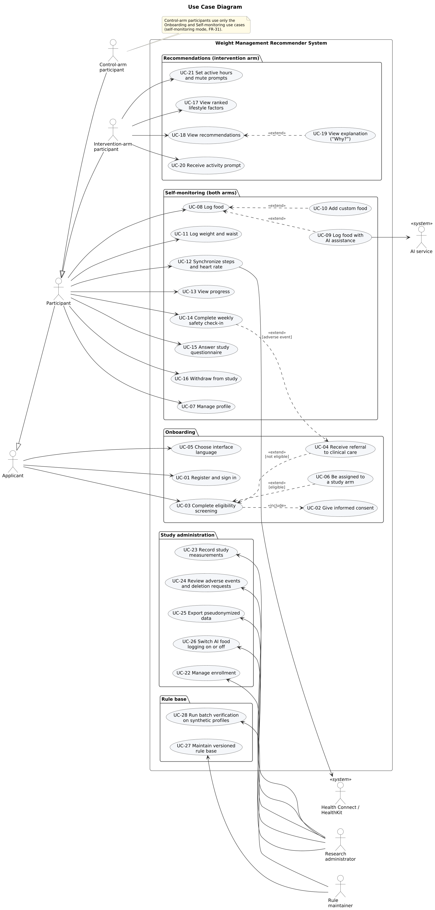

# Use Case Model

| | |
|---|---|
| **Pre-defense item** | 7. Architecture and diagrams (use case diagram) |
| **YouTrack task** | [DOA-10](https://yeralytemir.youtrack.cloud/issue/DOA-10) |
| **Version / date** | 0.1 draft, 22 October 2026 |
| **Inputs** | [Requirements specification](../requirements/requirements.md) v1.4 (FR-01 to FR-40); [prototype](../prototype/README.md) (DOA-11); [architecture](architecture.md) (DOA-9) |
| **Diagram** | Source [`diagrams/use-case.puml`](diagrams/use-case.puml); exports [PNG](diagrams/use-case.png), [SVG](diagrams/use-case.svg) |

---

## 1. Diagram

The diagram groups 28 use cases into five packages: onboarding, self-monitoring (both study arms), recommendations (intervention arm only), study administration and rule base. Use case names are written from the actor's point of view; identifiers (UC-xx) are used in the prototype description and in the architecture document.

---

## 2. Actors

The actors are the same as in the [system context diagram](architecture.md#2-system-context) (DOA-9) and follow the roles in Section 1.3 of the requirements.

| Actor | Type | Description | Requirements |
|---|---|---|---|
| **Applicant** | Primary, human | A person who registers and goes through consent and eligibility screening. A person who fails screening stays an applicant and receives only a referral (the "ineligible user" of the requirements). | FR-01 to FR-05 |
| **Participant** | Primary, human (abstract) | An enrolled, eligible adult. Generalizes the two study-arm actors and inherits all applicant use cases (for example, signing in and changing the language). | FR-06 to FR-12, FR-27, FR-28, FR-33 |
| **Intervention-arm participant** | Primary, human | A participant who also receives factor ranking, recommendations with explanations and activity prompts. | FR-13 to FR-26 |
| **Control-arm participant** | Primary, human | A participant who uses the same application in self-monitoring mode only: no factor ranking, recommendations or prompts. Has no use cases beyond those of *Participant*. | FR-31 |
| **Research administrator** | Primary, human | A team member who manages enrollment, records study measurements, reviews adverse events and exports pseudonymized data. | FR-30, FR-34 to FR-36, FR-40 |
| **Rule maintainer** | Primary, human | A team member who edits, versions and verifies the rule base. | FR-37, FR-38 |
| **Health Connect / HealthKit** | Secondary, system | The on-device health data store of Android and iOS; supplies steps from the phone and, when a wearable is connected, steps and heart rate from the wearable. | FR-10, FR-11, NFR-21 |
| **AI service** | Secondary, system | An external multimodal language model API that proposes candidate foods and portions for a meal description or photo. | FR-40, NFR-25 |

**Relationships between actors.** *Intervention-arm participant* and *Control-arm participant* specialize *Participant*, which specializes *Applicant*. The arm is not chosen by the person: it is assigned by randomization in UC-06 (FR-30).

---

## 3. Use Cases

"Includes" and "extends" follow UML: an included use case always runs as part of the base use case; an extending use case runs only under the stated condition.

| ID | Use case | Primary actor | Secondary actor | Short description | Requirements |
|---|---|---|---|---|---|
| UC-01 | Register and sign in | Applicant | – | Create an account, sign in on any device and sign out. | FR-01 |
| UC-02 | Give informed consent | Applicant | – | Read the study information and record consent (version, time) before any data are stored. Included in UC-03. | FR-02 |
| UC-03 | Complete eligibility screening | Applicant | – | Enter age, height, weight, exclusion conditions and PAR-Q+ answers; the system computes BMI and decides eligibility. Includes UC-02. | FR-04, FR-06 |
| UC-04 | Receive referral to clinical care | Applicant | – | Shown when screening fails (extends UC-03) or when a check-in reports an adverse event (extends UC-14); no recommendations are produced. | FR-05, FR-29 |
| UC-05 | Choose interface language | Applicant | – | Switch between Kazakh, Russian and English at any time without losing data. | FR-39 |
| UC-06 | Be assigned to a study arm | Applicant | – | After a positive screening, the system randomizes the person to the intervention or control arm and starts the baseline week (extends UC-03). | FR-30 |
| UC-07 | Manage profile | Participant | – | Edit age, sex, height, weight, waist and activity level; history is kept and BMI recalculated. | FR-06 |
| UC-08 | Log food | Participant | – | Search the food database, including local dishes, and log portions. | FR-07 |
| UC-09 | Log food with AI assistance | Participant | AI service | Describe or photograph a meal; confirm or correct the proposed foods before they are saved as an ordinary entry (extends UC-08). | FR-40 |
| UC-10 | Add custom food | Participant | – | Enter a missing food with nutrients per 100 g (extends UC-08). | FR-08 |
| UC-11 | Log weight and waist | Participant | – | Record body weight and waist circumference with a date. | FR-09 |
| UC-12 | Synchronize steps and heart rate | Participant | Health Connect / HealthKit | Grant permission and synchronize hourly steps and, with a wearable, heart rate; the first 7 days form the baseline week. | FR-10, FR-11, FR-12 |
| UC-13 | View progress | Participant | – | See weight trend, daily steps and intake; intervention-arm participants also see targets. | FR-27 |
| UC-14 | Complete weekly safety check-in | Participant | – | Answer the weekly adverse-event question; a reported event leads to UC-04 and pauses activity recommendations. | FR-28, FR-29 |
| UC-15 | Answer study questionnaire | Participant | – | Complete in-app questionnaires at study times, including SUS at week 12. | FR-33 |
| UC-16 | Withdraw from study | Participant | – | Stop participation and request deletion of personal data. | FR-03 |
| UC-17 | View ranked lifestyle factors | Intervention-arm participant | – | See modifiable factors ordered by deviation, each with value, target and rule ID. | FR-13, FR-14 |
| UC-18 | View recommendations | Intervention-arm participant | – | See energy and macronutrient targets, diet-quality and calcium flags, meal suggestions, step targets, heart-rate zone and resistance sessions, ordered by factor rank; only plans that pass the hard constraints are shown. | FR-15 to FR-20, FR-22, FR-24 |
| UC-19 | View explanation ("Why?") | Intervention-arm participant | – | Open the reason, rule ID and version, input values and evidence source of a recommendation (extends UC-18). | FR-23 |
| UC-20 | Receive activity prompt | Intervention-arm participant | – | Receive a notification when activity is below the personal threshold or sitting is prolonged; at most 3 per day, only in active hours. | FR-21, FR-25 |
| UC-21 | Set active hours and mute prompts | Intervention-arm participant | – | Set the time window for prompts and mute them for a day. | FR-26 |
| UC-22 | Manage enrollment | Research administrator | – | View enrollment status and arm sizes, withdraw a participant. | FR-30, FR-36 |
| UC-23 | Record study measurements | Research administrator | – | Enter weight and waist at weeks 0, 6 and 12 with a source flag; mark week-12 completion. | FR-34 |
| UC-24 | Review adverse events and deletion requests | Research administrator | – | See reported adverse events and withdrawal or deletion requests and act on them. | FR-03, FR-29, NFR-07 |
| UC-25 | Export pseudonymized data | Research administrator | – | Export engagement events, logs, check-ins, questionnaires and outcomes as CSV with a data dictionary and no direct identifiers. | FR-32, FR-35, NFR-03, NFR-27 |
| UC-26 | Switch AI food logging on or off | Research administrator | – | Enable or disable UC-09 for all users. | FR-40 |
| UC-27 | Maintain versioned rule base | Rule maintainer | – | Add or change rules with inputs, output, constraint and evidence source; each change creates a new version. | FR-37 |
| UC-28 | Run batch verification on synthetic profiles | Rule maintainer | – | Generate plans for 200 synthetic profiles and obtain a report of every hard-constraint result. | FR-38 |

**Cross-cutting requirements.** Two Must requirements are not separate user goals and are therefore not drawn as use cases:

- **FR-31 (control mode)** is modelled by the *Control-arm participant* actor, which has access only to the onboarding and self-monitoring use cases (note on the diagram).
- **FR-32 (engagement logging)** is a system behaviour: an event is recorded whenever a participant performs UC-01 to UC-21 (app open, logging action, prompt sent or opened, recommendation viewed). The events reach the research team through UC-25.

---

## 4. Requirement Coverage

### 4.1 Must requirements

Every Must functional requirement (28 of 40, requirements Section 8) appears in at least one use case.

| Must FR | Use case(s) | | Must FR | Use case(s) |
|---|---|---|---|---|
| FR-01 | UC-01 | | FR-22 | UC-18 |
| FR-02 | UC-02 | | FR-23 | UC-19 |
| FR-04 | UC-03 | | FR-24 | UC-18 |
| FR-05 | UC-04 | | FR-25 | UC-20 |
| FR-06 | UC-03, UC-07 | | FR-27 | UC-13 |
| FR-07 | UC-08 | | FR-28 | UC-14 |
| FR-09 | UC-11 | | FR-29 | UC-04, UC-14, UC-24 |
| FR-10 | UC-12 | | FR-30 | UC-06, UC-22 |
| FR-12 | UC-12 | | FR-31 | Control-arm participant (Section 3) |
| FR-13 | UC-17 | | FR-32 | UC-25, cross-cutting (Section 3) |
| FR-14 | UC-17 | | FR-35 | UC-25 |
| FR-15 | UC-18 | | FR-37 | UC-27 |
| FR-16 | UC-18 | | FR-38 | UC-28 |
| FR-18 | UC-18 | | FR-39 | UC-05 |

### 4.2 Should and Could requirements

| FR | Use case | | FR | Use case |
|---|---|---|---|---|
| FR-03 | UC-16, UC-24 | | FR-21 | UC-20 |
| FR-08 | UC-10 | | FR-26 | UC-21 |
| FR-11 | UC-12 | | FR-33 | UC-15 |
| FR-17 | UC-18 | | FR-34 | UC-23 |
| FR-19 | UC-18 | | FR-36 | UC-22 |
| FR-20 | UC-18 | | FR-40 | UC-09, UC-26 |

All 40 functional requirements are covered. The components that implement each use case are listed in the [architecture document](architecture.md#6-consistency-checks).

---

## 5. Open Points

1. The research administrator's interface (web console) is not yet designed; UC-22 to UC-26 are fixed, the screens are designed in DOA-17.
2. Screening questions (UC-03) and the referral text (UC-04) depend on the expert review of assumptions A12, E1 and E2 (requirements, Section 6.3).
3. UC-09 may be switched off for the pilot if the ethics approval does not allow sending meal photos or text to an external AI service (requirements, open question 2; DOA-24).
